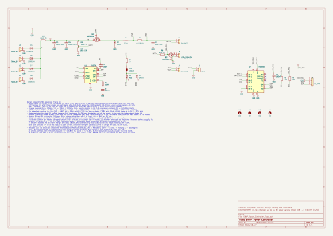
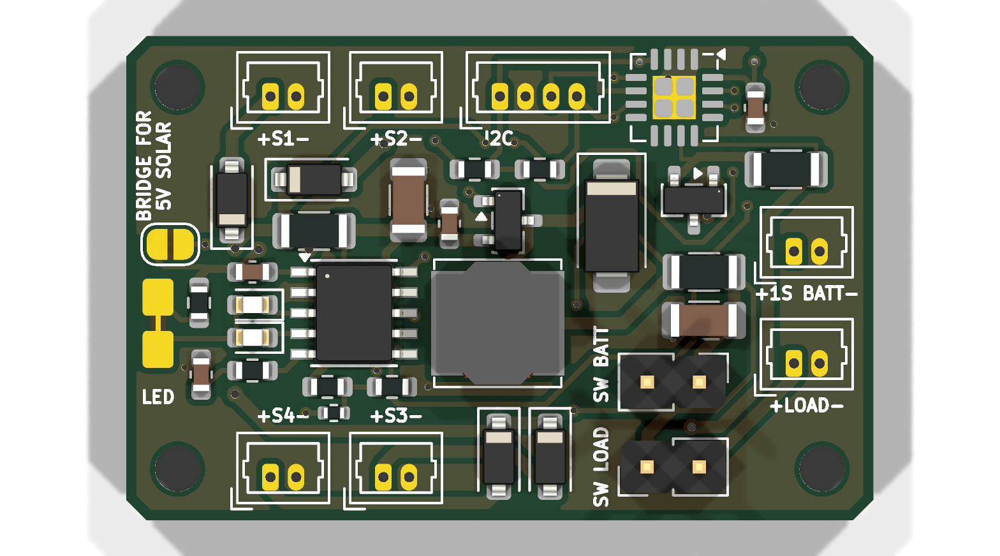

# SNAP Power Controller

A small solar charger board for a single-cell (1S) Li-ion/LiPo battery, built for solar-powered LoRa mesh nodes such as [SNAP v1.2](https://makerworld.com/en/models/3360988-snap-v1-2-solar-node-adaptable-platform-2x200ma). Up to four 6V panels feed a CN3791 MPPT buck charger. A switched output powers the node, and an INA3221 reports the battery's and the panels' voltage and current over I2C.

Designed in KiCad 10.

> **Status:** the schematic is complete and passes ERC. The PCB is a new, smaller layout (36.4 × 23.6 mm, 1mm corner chamfers, four M2 mounting holes, two layers), **placed by hand and routed**, with no DRC errors. It hasn't been built. A first v1.0 board has been wired up and tested with a XIAO + Wio-SX1262 on a custom Meshtastic build, and everything seems to work as expected so far, including the I2C sensor. A sunlight test in a real solar node is under way, with the expected voltage and charge current so far. See [Testing](#testing).
>
> **v1.1:** an INA3221 replaces v1.0's INA219 and its SOLAR/BATT switch, and reads the battery and the total solar input at the same time. The released v1.1 files are a 52 × 29mm board that also read panel 1 on its own. The board in this repo drops that channel and its shunt to fit in 36.4 × 23.6mm, and has no release yet. Neither has been built or tested; the test results below are from v1.0 boards with the INA219. See the [change log](CHANGELOG.md).

<p align="center">
  
</p>

## Built for solar mesh nodes

This controller is meant for solar mesh nodes like the [SNAP v1.2: Solar Node Adaptable Platform](https://makerworld.com/en/models/3360988-snap-v1-2-solar-node-adaptable-platform-2x200ma). It simplifies their build in three ways:

- **Easy, clean connections:** the panels, battery, node and switches each plug into their own connector.
- **Improved solar charging:** an MPPT charger tuned for 6V panels, with a diode for every panel built into the board.
- **I2C power sensing:** configurable for either the battery or the solar circuit.

I2C power sensors are supported natively by both [Meshtastic](https://meshtastic.org) and [MeshCore](https://github.com/meshcore-dev/MeshCore). In most cases the node recognizes the INA3221 automatically once it's connected.

<p align="center">
  
  
</p>

<p align="center">
  
</p>

In the SNAP v1.2 example build, shown below, the board replaces several separately wired parts:

<p align="center">
  
</p>

| Example build part | With this board |
|---|---|
| CN3158 MPPT module (SDBK03TA) | CN3791 MPPT buck charger, tuned for 6V panels (VIN held at 4.93V) and charging at 0.8A |
| One 1N5819 per panel, soldered inline | A 1N5819W per input on the board, for up to four panels |
| Hand-soldered panel, battery and node wiring | Plug-in connectors for every connection: Micro JST 1.25, with 2.54mm pin headers for the switches |
| Latching on/off switch wired into the battery lead | Two switch connectors: SW_BATT cuts the battery, SW_LOAD cuts only the node |
| (none) | INA3221 power monitor on I2C, reading the battery and the total solar input at once |

### Example wiring

| Board connector | Connects to |
|---|---|
| J1, J2 (Solar_6V) | Two 6V panels (12 cells, about 7.2V open-circuit). J3 and J4 take up to two more. The [FellDen 5V 200mA 110×60mm panels](https://www.amazon.com/dp/B0BND5NYGK) that SNAP v1.2 uses work too, once JP2 is soldered closed: see [Choosing panels](#choosing-panels) |
| J5 (BATT) | An 18650 Li-ion cell (1S, 3.0–4.2V) in its holder |
| J8 (SW_LOAD) | The SNAP on/off switch cap's latching button. To cut the battery entirely, use J7 (SW_BATT) as well, or instead |
| J7 / J8 left unswitched | Both switch connectors are in series with the power path, so an unused one needs a 2.54mm jumper cap, or a wire bridging its pads on the back of the board. Otherwise the battery or the node stays disconnected |
| J6 (VOUT) | The XIAO nRF52840's BAT+ / BAT− pads, which is where SNAP powers it from the 18650 today |
| J9 (I2C) | XIAO 3V3 → VCC, D6 → SDA, D7 → SCL, GND → GND, on a 4-wire cable coloured red VCC, black GND, yellow SCL, white SDA. These pins need a Meshtastic build with I2C on D6/D7 (see the table below) |
| JP1 (LED) | Nothing. JP1 is bridged by a trace as supplied, so the status LEDs work. To turn them off for good, cut the trace between its pads |
| JP2 (`BRIDGE FOR 5V SOLAR`) | Nothing with 6V panels: it's open as supplied. With 5V panels, bridge its two pads with solder |

The INA3221 reads the battery's charge and discharge current and what the panels deliver in total, both at the same time. There's no switch to set.

The XIAO's I2C pins depend on the firmware build. D4 and D5 can't be used with the Wio-SX1262, because the radio uses them.

| Firmware build | SDA | SCL | Status |
|---|---|---|---|
| Meshtastic `seeed_xiao_nrf52840_kit`, custom build with I2C on D6/D7 | D6 | D7 | Tested on this board |
| Meshtastic `seeed_xiao_nrf52840_kit_i2c` | D6 | D7 | From the firmware source, not tested |
| Meshtastic `seeed_xiao_nrf52840_kit`, unmodified (D6/D7 are reserved for the GNSS module) | NFC1 pad (underside) | NFC2 pad (underside) | From the firmware source, not tested |
| MeshCore `Xiao_nrf52` | D7 | D6 | From the firmware source, not tested |

The INA3221 uses address 0x42. Meshtastic also expects the DFRobot Lark weather sensor at 0x42, so the two can't share a bus.

In Meshtastic, enable power metrics in the telemetry settings so the readings are sent to the mesh.

## Features

- **Solar input:** up to four 6V panels in parallel (Micro JST 1.25), each isolated by its own 1N5819W Schottky (SOD-123), good for 0.5A per input, so a shaded or unplugged panel doesn't drag the others down.
- **MPPT charging:** [CN3791](https://naylampmechatronics.com/img/cms/001216/CN3791.PDF) PWM buck charger with constant-voltage MPPT set to 4.93V input for 6V panels, or 4.42V for 5V panels with JP2 (marked `BRIDGE FOR 5V SOLAR`) soldered closed. Charges at 0.8A to 4.2V (CC/CV, trickle charge for deeply discharged cells, automatic recharge).
- **Battery and load switching:** connectors for two panel-mount switches. **SW_BATT** disconnects the battery from everything. **SW_LOAD** cuts only the output, so the battery keeps charging.
- **Output:** VOUT connector (Micro JST 1.25) that powers the module from the battery.
- **Reverse-battery protection:** Q2, a P-channel MOSFET between the battery connector and the rest of the board. A cell plugged in backwards is blocked instead of shorting through the charger. With the cell the right way round, Q2 is fully on in both directions, adding about 60mV of drop at 0.8A.
- **Power monitoring:** [INA3221](https://www.ti.com/lit/ds/symlink/ina3221.pdf) at I2C address 0x42, on two channels: the battery (bidirectional current plus voltage) and the total solar input. The third channel is unused.
- **Status LEDs:** red while charging, green when charging is done. They're powered through JP1, marked `LED` on the top of the board: two pads joined by a trace. As supplied the LEDs work, and a lit LED draws about 3mA from the panels. Cut the trace to disconnect them; a solder blob across the pads turns them back on.

## Choosing panels

The board is tuned for "6V" panels: 12 cells, about 7.2V open-circuit and about 6V at maximum power at 25°C. The charger holds its input at 4.93V and each input diode drops about 0.35V, so a panel works at about 5.3V. A panel's maximum-power voltage falls about 0.4% per °C, to about 5V at a 65°C cell temperature, so the set point sits between a cool panel's maximum-power voltage and a hot one's.

| Panel | Open-circuit at 25°C | Share of maximum power at 25 / 45 / 65°C, as built (R3 = 309k, 4.93V) | With JP2 closed (4.42V) |
|---|---|---|---|
| "6V" panel, 12 cells | about 7.2V | 93 / 99 / 99% | 85 / 92 / 98% |
| "6V" panel with a lower maximum-power voltage (about 5.8V) | about 7.0V | 96 / 100 / 95% | 88 / 95 / 100% |
| "5V" panel, 10 cells | about 6.0V | 97 / 74 / 18% | 99 / 99 / 84% |
| "5V" panel that measures about 5.5V, like SNAP v1.2's | about 5.5V | 62 / 7 / 0% | 98 / 80 / 31% |

The temperatures are the panel cells', not the air's. All figures come from a single-diode panel model with the input diode's drop, not from measurements. For 6V panels, 309k is within a few percent of the best fixed set point from 25 to 65°C; 301k (4.83V) and 316k (5.01V) are close alternatives.

**With 5V panels, solder JP2 closed.** At 4.93V a 5V panel stops charging on hot days. JP2, marked `BRIDGE FOR 5V SOLAR` in the top-left corner of the board, puts R11 (1.96M) across R3: 309k ∥ 1.96M = 266.9k, which sets 4.42V, below the CN3791's specified 4.5V minimum input: typical parts run down to their 3.8V undervoltage lockout, but the datasheet doesn't guarantee it. 4.93V is inside the specification on every part. The loss with 5V panels comes from the diode drop as much as the set point: a lower-drop input diode, or an ideal-diode circuit rated above the panel's open-circuit voltage, would recover most of it.

## Schematic

[](docs/images/schematic.svg)

The schematic follows the CN3791 datasheet's typical application circuit (Figure 1), with these changes:

| Item | Value | Why |
|---|---|---|
| Charge current | 0.8A (R5 = 0.15Ω) | I<sub>CH</sub> = 120mV / R5. Leaves margin on the 1.0A-rated connectors; use 0.24Ω for 0.5A with small cells. |
| MPPT setpoint | 4.93V at VIN (R3/R4 = 309k/100k) | Chosen for 6V panels: about 7.2V open-circuit, with a maximum-power voltage of about 6V at 25°C and about 5V at a 65°C cell temperature. The panels sit one diode drop higher, about 5.3V: under a cool panel's maximum-power voltage and a little above a hot one's, which the model puts at 93–100% of the panel's maximum power from 25 to 65°C. V<sub>MPPT</sub> = 1.205V × (1 + R3/R4). Across the CN3791's 1.18–1.23V reference that's 4.83–5.03V, inside its 4.5V minimum input on every part. Charging starts once VIN passes about 5.03V (MPPT pin at 1.23V). For 5V panels, solder JP2 closed: that puts R11 = 1.96M across R3, making 266.9k (4.42V), the value this board had before. It's below the 4.5V minimum, but it's the only setting that keeps a 5V panel charging in heat. See [Choosing panels](#choosing-panels). The divider is 309k/100k and not 30.9k/10k so that it draws about 10µA, not 100µA, from the battery at night (see the next row); the MPPT pin's bias current (±100nA at most) moves the set point by under 31mV. |
| 5V option | R11 = 1.96M (0402) in series with JP2, an open solder jumper, both across R3 | Open as supplied, so R11 does nothing. Closed, R3 ∥ R11 = 266.9k. JP2 is on R11's VIN side, so with JP2 open the MPPT node gains only R11's pad and a short track; the line from JP2 to R11 runs on the bottom layer and is either tied to VIN or isolated by R11's 1.96M. |
| Blocking diode D1 | omitted | The input diodes already stop the battery feeding back into the panels, and leaving D1 out saves ~0.4V of headroom. The trade-off: in the dark the battery back-feeds VIN through L1 and Q1's body diode, so everything on VIN drains the battery. That is about 21µA into the CN3791 (datasheet figure) plus about 10µA through R3 and R4, roughly 30µA in all. Earlier files used 26.7k/10k, which made it about 115µA. Not measured on a board. |
| Inductor | 22µH, Bourns SRN6045TA | Meets the datasheet's L > 5 × (VCC − VBAT) µH, which is 20µH with a 6V panel's open-circuit voltage less a diode drop and a 2.8V cell. Ripple is about 0.15A at 4.93V in, 3.7V out. |
| Input diodes | 1N5819W, SOD-123 (40V/1A) | Rated 0.5A per input here: about 0.2W in the diode, which the SOD-123 package handles with margin in a warm enclosure. The first v1.1 files used the smaller SOD-323 1N5819WS, which is only good for about 0.3A. |

## PCB

<p align="center">
  
  
</p>

| Area | Parts |
|---|---|
| Corners | M2 mounting holes H1–H4 |
| Top edge | Solar inputs J1 (`+S1-`) and J2 (`+S2-`), the 4-pin I2C connector J9, then the INA3221 (U2) with its bypass capacitor C6 |
| Upper middle | Input diodes D5/D6 and the solar shunt R7, then the buck power stage: C1/C5, Q1, D2, with the I2C pull-ups R8/R9 above Q1. Right of D2: the charge-current shunt R5 and C3, the reverse-battery MOSFET Q2 and the battery shunt R6 |
| Middle | CN3791 (U1), with C2, the status LEDs D3/D4, R2 and C4 in a column on its left and the MPPT divider R3/R4 below it. L1 is to its right. JP1, the LED jumper, sits at the left edge with R1 beside it. R11 is tucked under R3 |
| Top-left corner | The 5V jumper JP2, left of D5, with its label above it |
| Right edge | Battery (J5, `+1S BATT-`) and VOUT (J6, `+LOAD-`) |
| Bottom edge | Solar inputs J4 (`+S4-`) and J3 (`+S3-`), directly under J1 and J2, with their diodes D8/D7, then the switch headers J7 (`SW BATT`) and J8 (`SW LOAD`) |

Reference designators aren't printed; the silkscreen carries only function labels. The holes are plain non-plated 2.2mm M2 holes, 2.5mm in from each edge.

### Dimensions

The [wiring diagram](#built-for-solar-mesh-nodes) includes a dimension drawing to scale.

| | |
|---|---|
| Outline | 36.4 × 23.6mm, with a 1mm × 45° chamfer on each corner |
| Thickness | 1.6mm PCB, two layers. All parts are on the top side; the through-hole connector pins stick out the back |
| Mounting holes | Four, 2.2mm diameter, not plated, for M2 screws |
| Hole positions | One in each corner, centre 2.5mm from both edges |
| Hole spacing | 31.4mm across, 18.6mm down, centre to centre |

**Silkscreen labels:**

- **Connector labels with polarity:** each solar, battery and VOUT connector has one label centred under or over it, with `+` on the pin-1 side and `-` on the GND side: `+S1-` to `+S4-` on J1–J4, `+1S BATT-` on J5 and `+LOAD-` on J6.
- **Switch headers:** `SW BATT` (J7) and `SW LOAD` (J8) are vertical labels left of the headers.
- **I2C connector:** `I2C` under J9 on the front. The pin names (`VCC`, `GND`, `SCL`, `SDA`) are printed under its pads on the back.
- **LED jumper:** `LED` under JP1.
- **5V jumper:** `BRIDGE FOR` / `5V SOLAR` on two lines, turned 90°, above JP2.
- **Back:** the module ID, "SNAP Power Controller v1.1 / Nov. 18, 2026". Under it, a reminder to check polarity, the limits listed under [Safety](#safety), and a short no-warranty notice.
- **Text size:** the front labels are 0.6mm text, the board's minimum. Board houses often recommend 0.8–1mm or more, so check that yours prints 0.6mm cleanly. The back label is 0.8 to 1.0mm.

**Routing** (a grid auto-router adapted from `tools/route-pcb.py`, with the tightest connections placed by hand first; the board file is the source of truth):

- **Switching loop:** C5/C1 → Q1 → D2 and the switch node to L1 are short 0.6mm tracks on the top layer. Only ground runs on the bottom layer under the loop, under L1's switch pad and under U2.
- **Ground:** both layers have a GND pour, and the bottom one is in one piece, cut only by short hops. Most surface-mount GND pads have their own via to it, including those of C1, C5 and D2 in the switching loop.
- **Track widths:** power paths are 0.6mm, 0.4mm where 0.6mm doesn't fit. Signals are 0.25mm, with 0.2mm on the INA3221's escape tracks.
- **Kelvin sensing:** the CN3791's current-sense pins and the INA3221's channel inputs connect straight to the pads of their shunt resistors (R5; R6, R7). The CN3791's pair runs side by side on the bottom layer, below L1.
- **Layer use:** about 315mm of track on the top layer and 96mm on the bottom. The gate drive (U1 to Q1) hops under the power stage on the bottom layer, because Q1's gate and source are on the same side.
- **Size:** 221 track segments and 39 vias, 11 of them on GND. JP2's line to R11 is the longest bottom-layer track: it runs down the left edge and along under J4.
- **Checks:** DRC reports 0 violations and 0 unconnected items, and schematic parity is clean.

Review it before ordering, especially the buck converter's switching loop (C1 → Q1 → D2, which returns through the ground plane).

Still to do: a manual layout review before ordering (see Fabrication).

## Connectors

| Ref | Connector | Pin 1 | Pin 2 | Notes |
|---|---|---|---|---|
| J1–J4 | Micro JST 1.25, 2-pin | Panel + | GND | 6V solar panels, any combination of 1–4 (5V panels with JP2 closed) |
| J5 | Micro JST 1.25, 2-pin | Battery + | GND | 1S Li-ion/LiPo, 4.2V |
| J6 | Micro JST 1.25, 2-pin | VOUT | GND | Battery voltage out to the powered module, through SW_LOAD |
| J7 | 2.54mm pin header, 2-pin | VBAT (charger) | BATT+ (battery) | SW_BATT: panel-mount SPST switch, rated ≥1A or the module's peak current |
| J8 | 2.54mm pin header, 2-pin | VBAT | VOUT | SW_LOAD: panel-mount SPST switch, same rating |
| J9 | Micro JST 1.25, 4-pin | VCC (3.3–5V) | GND | Pin 3 = SCL, pin 4 = SDA, matching the common red/black/yellow/white 4-wire cable. VCC comes from the MCU and powers the INA3221. v1.0 boards have SDA on pin 2 and GND on pin 4. |

J1–J6 and J9 are Micro JST 1.25 (Molex PicoBlade-compatible) vertical headers, Molex 53047-0210 (2-pin) and 53047-0410 (4-pin). They mate with standard female cable housings (Molex 51021). J7 and J8 are standard 2.54mm vertical pin headers, which take a 2.54mm female housing or a jumper cap. Notes:

- **Current:** PicoBlade contacts are rated 1.0A. The charge current is set to 0.8A to stay under that on the battery connector (J5). Keep the module's load current under 1A too, since it flows through J5 when the panels are dark.
- **No keying between functions:** J1–J6 are the same 2-pin type, so a battery lead fits a solar socket. Check the silkscreen before plugging in. The switch headers take a different plug, so they can't be mixed up with these.
- **Battery polarity:** "JST 1.25" LiPo pigtails have no standard polarity. Check that red goes to the pin marked `+` (pin 1 on J5) before connecting. Q2 blocks a reversed cell, but fit the cell with SW_BATT off anyway: with SW_BATT on in sunlight, the charger's output can partly turn Q2 on and push a limited current into a reversed cell, which heats Q2.
- **Reading the marks:** each of J1–J6 has a `+name-` label: pin 1 (`+`) is on the `+` side and GND on the `-` side. All six face the same way, so pin 1 is the left pin with the board read as printed.

**Operating note:** if SW_BATT is off while the panels are in sun, the charger sees no battery and VBAT pulses around 4.2V. Keep SW_LOAD off in that state.

## Power monitor (INA3221)

- **Address:** 0x42 (A0 = SDA). That's the INA3221 default in both Meshtastic and MeshCore.
- **Shunts:** both are 0.1Ω, which both firmwares assume. Full scale is ±163.8mV, so about ±1.64A, in 0.4mA steps.
- **What it can't measure:** sleep current. A sleeping node draws 50–100µA, which is 5–10µV across 0.1Ω, below the chip's 40µV step and its offset (up to 80µV). The monitor is for charge and load telemetry, in the tens to hundreds of milliamps; profile sleep current on the bench with a tool made for it. A larger battery shunt isn't an option here: 0.5–1Ω would drop 0.4–0.8V at the 0.8A charge current and exceed the chip's input range.
- **Pull-ups:** R8/R9 are 10k I2C pull-ups to the MCU's VCC. Leave them off if the MCU board already has pull-ups.

| Channel | Shunt | Current | Bus voltage |
|---|---|---|---|
| 1 | R6, between BATT+ and the cell | Positive while charging, negative while discharging | Cell voltage, readable even with SW_BATT off. It's measured after Q2, so it reads up to about 50mV off while current flows |
| 2 | R7, between the PV bus and VIN | Total solar current, always ≥ 0 | VIN (panel voltage minus the diode drop) |
| 3 | None: both inputs are tied to GND | Unused, reads zero | Unused, reads zero |

The released 52 × 29mm v1.1 board also had a shunt, R10, for panel 1 on channel 3. It was dropped to make the board smaller.

**Firmware support** (checked in the source code on 2026-11-09, not yet on hardware):
- **Meshtastic:** looks for an INA3221 at 0x42. It reports all three channels' voltage and current as power metrics (channel 3 reads about zero on this board), and uses channel 1 as the battery by default.
- **MeshCore:** the XIAO nRF52 build includes INA3221 support (`ENV_INCLUDE_INA3221`). It reports voltage, current and power for each channel.

## Testing

| Test | Setup | Status |
|---|---|---|
| First power-up | Board wired to a XIAO + Wio-SX1262, running Meshtastic built from `seeed_xiao_nrf52840_kit` with I2C on D6/D7 | Done. Everything seems to work as expected, including the INA219 over I2C |
| INA219 battery current | Same setup, battery at about 4V | Done. Discharging: about −12 to −15mA. Charging from the XIAO's USB: +100mA |
| Sunlight | Board wired into a real solar node with 4 × 60mA panels, with metrics tracked in Grafana dashboards | In progress. Voltage and charge current rose as expected when exposed to sunlight. One reading in the Meshtastic app: 4.56V, 110.5mA |

The signs match the expected convention: positive while charging, negative while discharging. The USB reading comes from the XIAO's own charger, so it doesn't test the CN3791. The sunlight reading is from SW3's SOLAR position: 4.56V is above a Li-ion cell's 4.2V and close to the 4.58V MPPT set point of the board tested (v1.1 lowered it to 4.42V, and the board in this repo uses 4.93V for 6V panels). It's a single reading, and longer-term results are still to come. These tests used a board with Micro JST 1.25 connectors on J7 and J8, so the pin-header version hasn't been built yet. In the sunlight test build, J7 and J8 are bridged with wire on the back of the board, so neither switch is fitted.

<p align="center">
  
  
</p>

## Safety

This is an experimental design for charging a lithium-ion cell. It's provided as is, with no warranty, and hasn't been certified to any safety standard. If you build it, you're responsible for:

- Assembling it correctly and checking connector polarity before connecting a cell. J1–J6 share one connector type, so a lead plugs into the wrong socket easily. Q2 protects against a reversed cell on J5, but not against every fault, such as a battery plugged into a solar input.
- Using a protected cell or a separate protection circuit. The CN3791 charges the cell but doesn't protect it from over-discharge or short circuits.
- Fusing, wiring and an enclosure suited to where the node is installed, including outdoor heat and moisture.
- Not using it where a failure could hurt someone or damage property.

**Limits**, also printed on the back of the board:

| | Limit | Set by |
|---|---|---|
| Battery | One Li-ion or LiPo cell (1S), charged to 4.2V | The CN3791's fixed charge voltage |
| Panel voltage | 20V open-circuit at most. The board is tuned for 6V panels; 5V panels need JP2 closed, and a higher-voltage panel delivers little power without a new R3 | The 25V input capacitors and the CN3791's MPPT pin |
| Panel current | 0.5A per input | Heat in each input's 1N5819W diode |
| Load on VOUT | 1A | The connector contacts at J5 and J6 |

**No warranty:** the board is provided as is, and you use it at your own risk. Where the law allows a limit, liability for a board you bought is limited to the price you paid for it. The design itself is covered by the disclaimer in the [licence](#license).

## Fabrication

The [latest release](https://github.com/jaisor/SNAP_Power_Controller/releases/latest) is v1.1 as first laid out: the 52 × 29mm board with panel 1's channel. Its files don't match the board in this repo. The 36.4 × 23.6mm board has no release yet; generate its package with the commands below. The [change log](CHANGELOG.md) lists what changed. The package is generated into `output/fab/`, which isn't tracked in git:

| File | Contents |
|---|---|
| `SolarChargeModule_v1.1_gerbers.zip` | Upload this to the board house. 9 Gerber X2 layers (copper, mask, paste and silkscreen on both sides, plus the outline), a Gerber job file, plated and non-plated Excellon drill files, and drill maps |
| `FAB_NOTES.txt` | Order settings: 2 layers, FR-4 1.6mm, 1oz copper, 36.4 × 23.6mm, 0.2mm/0.2mm minimum track/space, 0.3mm minimum drill, tented vias, four 2.2mm non-plated holes. Also assembly cautions |
| `SolarChargeModule_v1.1_BOM.csv` | BOM in JLCPCB format (Comment, Designator, Footprint, LCSC Part #), plus a Manufacturer Part column for the specific parts |
| `SolarChargeModule_v1.1_CPL.csv` | Pick-and-place file for top-side assembly, in the same coordinates as the Gerbers |

LCSC part numbers are only filled in where verified (D5–D8). Pick the rest in the assembler's part search, and check rotation and polarity in their preview. The PicoBlade headers and the J7 and J8 pin headers are through-hole parts. JP1 is two bare pads joined by a trace and JP2 is an open solder jumper, so neither has a part to place.

Regenerating the package (after the board is final and DRC is clean):

```bash
OUT=output/fab
P=SNAP_Power_Controller
kicad-cli pcb export gerbers --layers F.Cu,B.Cu,F.Paste,B.Paste,F.Silkscreen,B.Silkscreen,F.Mask,B.Mask,Edge.Cuts --subtract-soldermask --check-zones -o $OUT/gerbers $P.kicad_pcb
kicad-cli pcb export drill --format excellon --excellon-units mm --excellon-zeros-format decimal --drill-origin absolute --excellon-separate-th --generate-map --map-format gerberx2 -o $OUT/gerbers/ $P.kicad_pcb
kicad-cli pcb export pos --format csv --units mm --side both -o $OUT/pos-kicad.csv $P.kicad_pcb
kicad-cli sch export bom --fields 'Value,Reference,Footprint,${QUANTITY}' --labels 'Comment,Designator,Footprint,Qty' --group-by 'Value,Footprint' --ref-range-delimiter '' --exclude-dnp -o $OUT/bom-kicad.csv $P.kicad_sch
node tools/fab-package.js $OUT
```

## Repository layout

```
SNAP_Power_Controller.kicad_pro / .kicad_sch / .kicad_pcb   KiCad project
SolarNode.kicad_sym             project symbol library (CN3791)
sym-lib-table
tools/
  gen-schematic.js              generates the 52 × 29mm board's schematic, with R10 (Node)
  place-pcb.py                  places the 52 × 29mm board: footprints, labels, holes, outline (KiCad Python / pcbnew)
  draw-routes.py                draws the 52 × 29mm board's tracks, vias and GND pours (run after place-pcb.py)
  route-pcb.py                  the earlier auto-router, kept for reference (v1.0's copper came from it)
  make-diagram.py               draws docs/images/wiring-diagram.png from the board render
  fab-package.js                JLCPCB-style BOM/CPL, fab notes and Gerber zip from the kicad-cli exports
docs/images/                    images used in this README (snap/: photos from the SNAP v1.2 MakerWorld post)
CLAUDE.md                       design decisions and working notes
LICENSE                         CERN-OHL-P-2.0 (hardware design and documentation)
tools/LICENSE                   MIT (scripts)
```

The current schematic and board were edited by hand in KiCad and are checked with `kicad-cli` ERC/DRC (including schematic parity). The generator scripts in `tools/` build the earlier 52 × 29mm design. See [CLAUDE.md](CLAUDE.md) for the full design rationale and workflow. Generated outputs (`output/`: BOM, reports, fab files) are not tracked.

## Regenerating the design

**Don't run steps 1–3 on the current design.** They rebuild the earlier 52 × 29mm board with R10, and they overwrite the schematic and board files. The current schematic and board were edited by hand in KiCad. The steps stay here for that design. Run them from the repo root, with `kicad-cli` from KiCad 10:

```bash
# 1. Schematic (Node): rewrites the .kicad_sch, SolarNode.kicad_sym and sym-lib-table
node tools/gen-schematic.js
kicad-cli sch erc --format json --severity-all -o erc.json SNAP_Power_Controller.kicad_sch
# 2. Netlist for the board scripts
kicad-cli sch export netlist --format kicadxml -o net.xml SNAP_Power_Controller.kicad_sch
# 3. Board (KiCad's Python): placement + labels + holes + outline, then tracks + GND pours
"C:/Program Files/KiCad/10.0/bin/python.exe" tools/place-pcb.py net.xml
"C:/Program Files/KiCad/10.0/bin/python.exe" tools/draw-routes.py
# 4. Check: expect 0 violations, 0 unconnected, 0 parity issues
kicad-cli pcb drc --schematic-parity --severity-all --format json -o drc.json SNAP_Power_Controller.kicad_pcb
```

The scripts overwrite their output files. Once you edit the schematic or board in KiCad, stop regenerating that file (or port your edits into the scripts first).

Refreshing the images in `docs/images/`:

```bash
kicad-cli sch export svg -o docs/images SNAP_Power_Controller.kicad_sch
kicad-cli pcb render --side top --width 1600 --height 900 --quality high --zoom 1.35 -o docs/images/pcb-top.png SNAP_Power_Controller.kicad_pcb
kicad-cli pcb render --side bottom --width 1600 --height 900 --quality high --zoom 1.35 -o docs/images/pcb-bottom.png SNAP_Power_Controller.kicad_pcb
kicad-cli pcb render --width 1600 --height 1000 --quality high --perspective --rotate "-40,0,-25" -o docs/images/pcb-iso.png SNAP_Power_Controller.kicad_pcb
```

(The schematic export is named `SNAP_Power_Controller.svg`; rename it to `schematic.svg`.)

After refreshing `pcb-top.png`, redraw the wiring diagram with KiCad's Python, which includes Pillow and NumPy:

```bash
"C:/Program Files/KiCad/10.0/bin/python.exe" tools/make-diagram.py
```

## License

Copyright 2026 Jordan Marinov (JaisorGadgets).

The hardware design (schematic, board, symbol library) and its documentation, including the images in `docs/images/`, are licensed under the [CERN Open Hardware Licence Version 2 – Permissive](LICENSE) (CERN-OHL-P-2.0). You may redistribute and modify them, and make and sell products from them, under the terms of the licence. They are distributed WITHOUT ANY EXPRESS OR IMPLIED WARRANTY, INCLUDING OF MERCHANTABILITY, SATISFACTORY QUALITY AND FITNESS FOR A PARTICULAR PURPOSE. See section 5 of the licence for the disclaimer and limitation of liability.

The scripts in `tools/` are licensed under the [MIT License](tools/LICENSE).

Source location: https://github.com/jaisor/SNAP_Power_Controller
