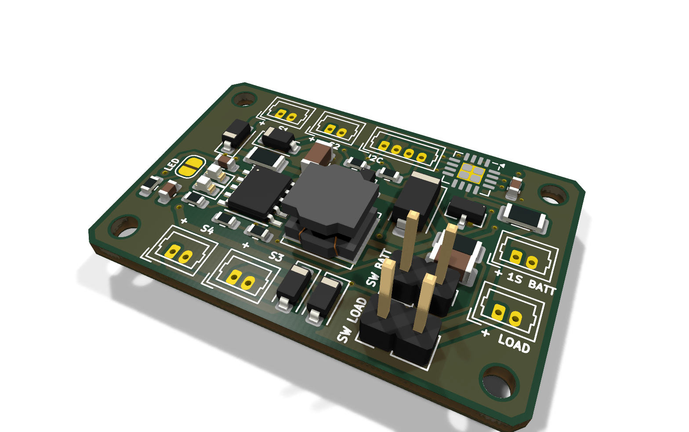
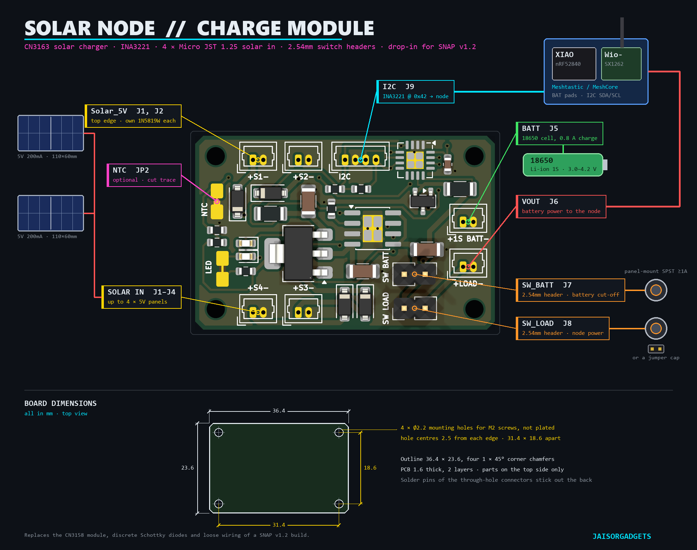
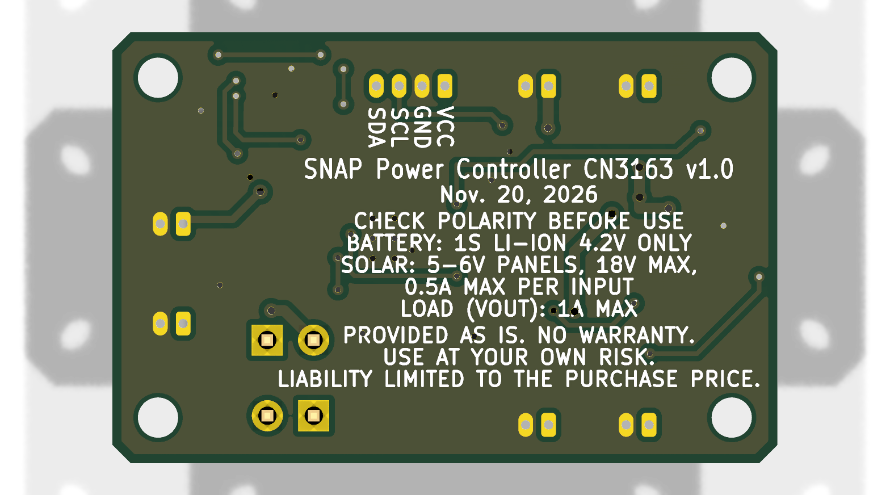
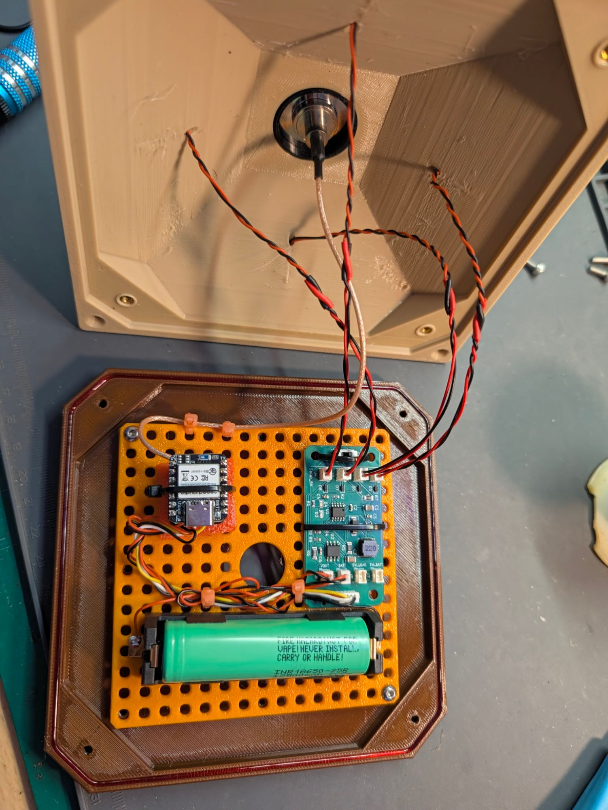
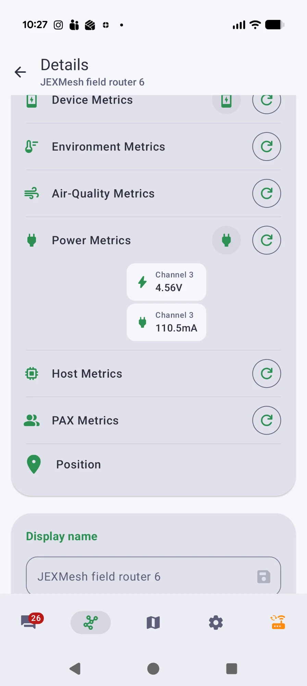

# SNAP Power Controller

A small solar charger board for a single-cell (1S) Li-ion/LiPo battery, built for solar-powered LoRa mesh nodes such as [SNAP v1.2](https://makerworld.com/en/models/3360988-snap-v1-2-solar-node-adaptable-platform-2x200ma). Up to four 5V panels feed a CN3163 linear charger through a 5V input limiter. A switched output powers the node, and an INA3221 reports the battery's and the panels' voltage and current over I2C.

Designed in KiCad 10.

> **Branch `cn3163`:** this is a variant of the board on `main`. A CN3163 linear solar charger replaces `main`'s CN3791 buck charger. The board is the same size as `main`'s, with the same connectors in the same places.
>
> What changes in the circuit:
>
> - **Removed:** the switching stage and its support parts: Q1, D2, L1, the sense resistor R5, the MPPT divider R3/R4, C2, C4, C5 and the old R2. Ten parts go, one comes back (the new R2).
> - **Added:** R2 = 1.5k, which sets the charge current to 0.79A (1188V / R2). Also U3, an LDL1117S50R 5V regulator with its output capacitor C2, as an input voltage limiter.
> - **Kept:** the four diode-isolated solar inputs, the INA3221 and its two shunts, both switch headers, the reverse-battery FET, the status LEDs behind JP1, and every connector and pinout.
> - **Panel voltage:** every CN3163 pin has a 6.5V absolute maximum, and a panel floats to its open-circuit voltage once the battery is full. U3 sits between the panels and the charger and holds the charger's supply at 5.0V, so panels up to 18V open-circuit are safe. While charging, the CN3163 pulls the panels down to about 4.5V and U3 is simply fully on, costing about 0.3Ω: roughly 70mV at 0.25A and 0.25V at 0.8A. The board is still meant for 5–6V panels; anything higher only makes heat.
> - **Solar tracking is built in and fixed.** The CN3163 cuts the charge current to keep its input at 4.4V or above, so there is no set point to tune.
> - **It is a linear charger.** The difference between input and battery voltage is lost as heat in the chip, about 0.55W at 0.79A from panels, and up to about 1W when the supply holds 5V. It reduces the current by itself to stay near 130°C.

> **Status:** the schematic is complete and passes ERC. The PCB (36.4 × 23.6 mm, 1mm corner chamfers, four M2 mounting holes, two layers) is **placed and routed**, with no DRC errors and no schematic parity issues. It hasn't been built, and it hasn't had a manual layout review. The test results under [Testing](#testing) are from v1.0 boards with the CN3791 and an INA219.

<p align="center">
  
</p>

## Built for solar mesh nodes

This controller is meant for solar mesh nodes like the [SNAP v1.2: Solar Node Adaptable Platform](https://makerworld.com/en/models/3360988-snap-v1-2-solar-node-adaptable-platform-2x200ma). It simplifies their build in three ways:

- **Easy, clean connections:** the panels, battery, node and switches each plug into their own connector.
- **Solar charging for 5V panels:** a charger that holds its input at 4.4V or above, so a weak panel isn't dragged down, with a diode for every panel built into the board.
- **I2C power sensing:** the battery and the total solar input, read at the same time.

I2C power sensors are supported natively by both [Meshtastic](https://meshtastic.org) and [MeshCore](https://github.com/meshcore-dev/MeshCore). In most cases the node recognizes the INA3221 automatically once it's connected.

<p align="center">
  
  
</p>

<p align="center">
  
</p>

In the SNAP v1.2 example build, shown below, the board replaces several separately wired parts:

<p align="center">
  
</p>

| Example build part | With this board |
|---|---|
| CN3158 MPPT module (SDBK03TA) | CN3163 linear solar charger, holding its input at 4.4V or above and charging at 0.79A, behind a 5V input limiter |
| One 1N5819 per panel, soldered inline | A 1N5819W per input on the board, for up to four panels |
| Hand-soldered panel, battery and node wiring | Plug-in connectors for every connection: Micro JST 1.25, with 2.54mm pin headers for the switches |
| Latching on/off switch wired into the battery lead | Two switch connectors: SW_BATT cuts the battery, SW_LOAD cuts only the node |
| (none) | INA3221 power monitor on I2C, reading the battery and the total solar input at once |

### Example wiring

| Board connector | Connects to |
|---|---|
| J1, J2 (Solar_5V) | Two [FellDen 5V 200mA 110×60mm panels](https://www.amazon.com/dp/B0BND5NYGK), the ones SNAP v1.2 uses. J3 and J4 take up to two more |
| J5 (BATT) | An 18650 Li-ion cell (1S, 3.0–4.2V) in its holder |
| J8 (SW_LOAD) | The SNAP on/off switch cap's latching button. To cut the battery entirely, use J7 (SW_BATT) as well, or instead |
| J7 / J8 left unswitched | Both switch connectors are in series with the power path, so an unused one needs a 2.54mm jumper cap, or a wire bridging its pads on the back of the board. Otherwise the battery or the node stays disconnected |
| J6 (VOUT) | The XIAO nRF52840's BAT+ / BAT− pads, which is where SNAP powers it from the 18650 today |
| J9 (I2C) | XIAO 3V3 → VCC, D6 → SDA, D7 → SCL, GND → GND, on a 4-wire cable coloured red VCC, black GND, yellow SCL, white SDA. These pins need a Meshtastic build with I2C on D6/D7 (see the table below) |
| JP1 (LED) | Nothing. JP1 is bridged by a trace as supplied, so the status LEDs work. To turn them off for good, cut the trace between its pads |
| JP2 (NTC) | Nothing, or a 10k B3950 NTC taped to the cell. JP2 is bridged as supplied, which turns temperature sensing off. To use the NTC, cut the trace between JP2's pads and solder the NTC's wires to them |

The INA3221 reads the battery's charge and discharge current and what the panels deliver in total, both at the same time. There's no switch to set.

The XIAO's I2C pins depend on the firmware build. D4 and D5 can't be used with the Wio-SX1262, because the radio uses them.

| Firmware build | SDA | SCL | Status |
|---|---|---|---|
| Meshtastic `seeed_xiao_nrf52840_kit`, custom build with I2C on D6/D7 | D6 | D7 | Tested on a v1.0 board |
| Meshtastic `seeed_xiao_nrf52840_kit_i2c` | D6 | D7 | From the firmware source, not tested |
| Meshtastic `seeed_xiao_nrf52840_kit`, unmodified (D6/D7 are reserved for the GNSS module) | NFC1 pad (underside) | NFC2 pad (underside) | From the firmware source, not tested |
| MeshCore `Xiao_nrf52` | D7 | D6 | From the firmware source, not tested |

The INA3221 uses address 0x42. Meshtastic also expects the DFRobot Lark weather sensor at 0x42, so the two can't share a bus.

In Meshtastic, enable power metrics in the telemetry settings so the readings are sent to the mesh.

## Features

- **Solar input:** up to four 5V panels in parallel (Micro JST 1.25), each isolated by its own 1N5819W Schottky (SOD-123), good for 0.5A per input, so a shaded or unplugged panel doesn't drag the others down.
- **Input limiter:** U3, an LDL1117S50R 5.0V regulator (ST), keeps the charger's supply at or below 5V, so panels up to 18V open-circuit can't damage the 6.5V-rated charger. While charging it is fully on and only adds its on-resistance.
- **Charging:** [CN3163](https://kaspars.net/wp-content/uploads/2023/12/CN3163.pdf) linear charger for one cell. Charges at 0.79A to 4.2V (1%), CC/CV, with a 10% precharge for deeply discharged cells, termination at 10% of the charge current and automatic recharge. An on-chip loop reduces the charge current to keep its input at 4.4V or above, and thermal regulation reduces it to keep the chip near 130°C.
- **Battery and load switching:** connectors for two panel-mount switches. **SW_BATT** disconnects the battery from everything. **SW_LOAD** cuts only the output, so the battery keeps charging.
- **Output:** VOUT connector (Micro JST 1.25) that powers the module from the battery.
- **Reverse-battery protection:** Q2, a P-channel MOSFET between the battery connector and the rest of the board. A cell plugged in backwards is blocked instead of shorting through the charger. With the cell the right way round, Q2 is fully on in both directions, adding about 60mV of drop at 0.8A.
- **Power monitoring:** [INA3221](https://www.ti.com/lit/ds/symlink/ina3221.pdf) at I2C address 0x42, on two channels: the battery (bidirectional current plus voltage) and the total solar input. The third channel is unused.
- **Battery temperature (optional):** with a 10k B3950 NTC against the cell, wired to JP2's pads, the CN3163 pauses charging below about 1°C and above about 46°C. JP2 is bridged by a thin trace as supplied, which turns sensing off; cut the trace to use the NTC.
- **Status LEDs:** red while charging, green when charging is done. They're powered through JP1, marked `LED` on the top of the board: two pads joined by a trace, the same as JP2. As supplied the LEDs work, and a lit LED draws about 3mA from the panels (never from the cell). Cut the trace to disconnect them; a solder blob across the pads turns them back on.

## Choosing panels

While charging, the CN3163 holds its input at 4.4V or above. Each input diode drops about 0.35V and U3 another 0.07–0.25V, so a panel has to deliver its power at about 4.8–5.0V. A panel's maximum-power voltage falls about 0.4% per °C, so what matters is how the panel does hot, not at its rated 25°C.

- **"6V" panels** (12 cells, about 7.2V open-circuit) are preferred. They stay above that voltage in heat.
- **"5V" panels** (10 cells, about 6.0V open-circuit) lose part of their output on hot days, when their maximum-power voltage falls to about 4.2V.
- **"5V" panels that only reach about 5.5V open-circuit** lose most of their output in heat.

There is no setting to change for a different panel: the CN3163's 4.4V input threshold is fixed. `main`'s README models the CN3791 board, whose set point is about the same, for the two kinds of 5V panel; expect a little less here, because of U3's drop.

## Schematic

[](docs/images/schematic.svg)

The schematic follows the CN3163 datasheet's typical application circuit (Figure 1), with these changes:

| Item | Value | Why |
|---|---|---|
| Charge current | 0.79A (R2 = 1.5k) | I<sub>CH</sub> = 1188V / R2. Leaves margin on the 1.0A-rated connectors; use 2.4k for 0.5A with small cells. |
| Input limiter U3 | LDL1117S50R, 5.0V, SOT-223 | Every CN3163 pin is rated 6.5V at most, and an unloaded panel sits at its open-circuit voltage. A shunt clamp would have to sink about half of each panel's short-circuit current to hold it down, and an overvoltage cut-off would switch off in bright sun, so a series regulator was used. U3 is rated for 18V in (20V absolute maximum). Its output capacitor C2 is 10µF. |
| Status LED supply | From U3's output | The LEDs' resistor R1 and JP1 take their supply after U3, because CHRG and DONE are 6.5V pins too. |
| Battery capacitor C3 | 10µF | The datasheet asks for 1µF to 22µF on BAT. |
| Temperature divider | R3 = 4.7k (VCHG to TEMP), R4 = 47k (TEMP to GND), NTC across R4 | The datasheet's Figure 7. Charging runs while TEMP is between 45% and 80% of the CN3163's supply, so the window doesn't depend on the panel voltage. Sized for a 10k B3950 NTC and 0–45°C, the exact values are 4.86k and 46.1k; 4.7k and 47k give about 1–46°C. |
| Temperature jumper JP2 | Bridged by a trace; its pads are the NTC's pads | Without an NTC, TEMP would sit at 91% and charging would never start. Bridged, JP2 holds TEMP at GND, which turns sensing off, as the datasheet allows. R3 then draws about 1mA from the 5V supply while the panels are lit. Cut the trace before fitting the NTC. |
| Blocking diode | none | The input diodes stop the battery feeding back into the panels. In the dark the CN3163 sleeps and draws under 3µA from the battery (datasheet figure, not measured on a board). |
| Input diodes | 1N5819W, SOD-123 (40V/1A) | Rated 0.5A per input here: about 0.2W in the diode, which the SOD-123 package handles with margin in a warm enclosure. |

## PCB

<p align="center">
  
  
</p>

| Area | Parts |
|---|---|
| Corners | M2 mounting holes H1–H4 |
| Top edge | Solar inputs J1 (`+S1-`) and J2 (`+S2-`), the 4-pin I2C connector J9, then the INA3221 (U2) with its bypass capacitor C6 |
| Upper middle | Input diodes D5/D6, the solar shunt R7 and the input capacitor C1, with the I2C pull-ups R8/R9 above the charger and its current-setting resistor R2 beside them. On the right: the reverse-battery MOSFET Q2 and the battery shunt R6 |
| Middle | CN3163 (U1), with the 5V limiter U3 below and to its left. The limiter's output capacitor C2 is under U1, and the battery capacitor C3 to its right. The status LEDs D3/D4 and R1 sit beside the LED solder jumper JP1 at the left edge |
| Left edge, top | The NTC pads JP2 (`NTC`) left of D5, with the temperature divider R3/R4 below them |
| Right edge | Battery (J5, `+1S BATT-`) and VOUT (J6, `+LOAD-`) |
| Bottom edge | Solar inputs J4 (`+S4-`) and J3 (`+S3-`), directly under J1 and J2, with their diodes D8/D7, then the switch headers J7 (`SW BATT`) and J8 (`SW LOAD`) |

The connectors, the INA3221, the input diodes, the shunts, Q2 and the LEDs are in exactly the same places as on `main`'s board (JP1 sits 3.2mm lower and R1 lies flat under D3, to make room for R3/R4); only the charger parts in the middle differ. Reference designators aren't printed; the silkscreen carries only function labels. The holes are plain non-plated 2.2mm M2 holes, 2.5mm in from each edge. Mount the board with nylon washers and standoffs; see [Dimensions](#dimensions).

The CN3163's 3D model doesn't show in the renders (the footprint's model file seems to be missing from KiCad's library); only its pads appear.

### Dimensions

The [wiring diagram](#built-for-solar-mesh-nodes) includes a dimension drawing to scale.

| | |
|---|---|
| Outline | 36.4 × 23.6mm, with a 1mm × 45° chamfer on each corner |
| Thickness | 1.6mm PCB, two layers. All parts are on the top side; the through-hole connector pins stick out the back |
| Mounting holes | Four, 2.2mm diameter, not plated, for M2 screws |
| Mounting hardware | M2 screws with heads no wider than 4mm, and nylon washers and standoffs. **Don't use metal washers or metal standoffs:** a 5mm M2 washer reaches within 0.3mm of C6's bare pad at H2, and tracks pass about 3mm from the hole centres |
| Hole positions | One in each corner, centre 2.5mm from both edges |
| Hole spacing | 31.4mm across, 18.6mm down, centre to centre |

**Silkscreen labels:**

- **Connector labels with polarity:** each solar, battery and VOUT connector has one label centred under or over it, with `+` on the pin-1 side and `-` on the GND side: `+S1-` to `+S4-` on J1–J4, `+1S BATT-` on J5 and `+LOAD-` on J6.
- **Switch headers:** `SW BATT` (J7) and `SW LOAD` (J8) are vertical labels left of the headers.
- **I2C connector:** `I2C` under J9 on the front. The pin names (`VCC`, `GND`, `SCL`, `SDA`) are printed under its pads on the back.
- **LED jumper:** `LED` beside JP1.
- **NTC pads:** `NTC` above JP2.
- **Back:** the module ID, "SNAP Power Controller CN3163 v1.0 / Nov. 20, 2026". Under it, a reminder to check polarity, the limits listed under [Safety](#safety), and a short no-warranty notice.
- **Text size:** the front labels are 0.6mm text, the board's minimum. Board houses often recommend 0.8–1mm or more, so check that yours prints 0.6mm cleanly. The back label is 0.8 to 1.0mm.

**Routing** (a grid auto-router adapted from `tools/route-pcb.py`, with the tightest connections placed by hand first; the board file is the source of truth):

- **Ground:** both layers have a GND pour, and the bottom one is cut only by short hops. Most surface-mount GND pads have their own via to it. Six vias in the CN3163's exposed pad carry its heat to the bottom plane, and no track runs on the bottom layer under the chip.
- **Power path:** R7 → C1 → U3 → U1 → C3 → J7 runs on short tracks on the top layer.
- **Track widths:** power paths are 0.6mm, 0.4mm where 0.6mm doesn't fit. Signals are 0.25mm, with 0.2mm on the INA3221's escape tracks.
- **Kelvin sensing:** the INA3221's channel inputs connect straight to the pads of their shunt resistors (R6, R7).
- **Temperature line:** TEMP runs on the bottom layer from U1 pin 1 to the NTC pads, under the input diodes, so it is the one long track that cuts the bottom ground plane.
- **Layer use:** about 277mm of track on the top layer and 84mm on the bottom.
- **Size:** 199 track segments and 44 vias, 17 of them on GND. VCHG reaches the NTC divider (R3) on the bottom layer, under JP1.
- **Mounting holes:** no copper except ground comes within 3mm of a hole centre, apart from two bare pads: C6's at H2 (2.8mm) and JP1's at H3 (2.7mm, fed through R1, 1k). That's why the hardware must be nylon.
- **Checks:** DRC reports 0 violations and 0 unconnected items, and schematic parity is clean.

Review it before ordering, especially the charger's heat path (the exposed pad, its vias and the ground plane).

Still to do: a manual layout review before ordering (see Fabrication).

## Connectors

| Ref | Connector | Pin 1 | Pin 2 | Notes |
|---|---|---|---|---|
| J1–J4 | Micro JST 1.25, 2-pin | Panel + | GND | 5V solar panels, any combination of 1–4 |
| J5 | Micro JST 1.25, 2-pin | Battery + | GND | 1S Li-ion/LiPo, 4.2V |
| J6 | Micro JST 1.25, 2-pin | VOUT | GND | Battery voltage out to the powered module, through SW_LOAD |
| J7 | 2.54mm pin header, 2-pin | VBAT (charger) | BATT+ (battery) | SW_BATT: panel-mount SPST switch, rated ≥1A or the module's peak current |
| J8 | 2.54mm pin header, 2-pin | VBAT | VOUT | SW_LOAD: panel-mount SPST switch, same rating |
| J9 | Micro JST 1.25, 4-pin | VCC (3.3–5V) | GND | Pin 3 = SCL, pin 4 = SDA, matching the common red/black/yellow/white 4-wire cable. VCC comes from the MCU and powers the INA3221. v1.0 boards have SDA on pin 2 and GND on pin 4. |

J1–J6 and J9 are Micro JST 1.25 (Molex PicoBlade-compatible) vertical headers, Molex 53047-0210 (2-pin) and 53047-0410 (4-pin). They mate with standard female cable housings (Molex 51021). J7 and J8 are standard 2.54mm vertical pin headers, which take a 2.54mm female housing or a jumper cap. Notes:

- **Current:** PicoBlade contacts are rated 1.0A. The charge current is set to 0.79A to stay under that on the battery connector (J5). Keep the module's load current under 1A too, since it flows through J5 when the panels are dark.
- **No keying between functions:** J1–J6 are the same 2-pin type, so a battery lead fits a solar socket. Check the silkscreen before plugging in. The switch headers take a different plug, so they can't be mixed up with these.
- **Battery polarity:** "JST 1.25" LiPo pigtails have no standard polarity. Check that red goes to the pin marked `+` (pin 1 on J5) before connecting. Q2 blocks a reversed cell, but fit the cell with SW_BATT off anyway: with SW_BATT on in sunlight, the charger's output can partly turn Q2 on and push a limited current into a reversed cell, which heats Q2.
- **NTC:** JP2 is not a connector: its two pads take the NTC's wires directly. Either way round works. Keep the NTC on the cell, away from the board: the CN3163 itself runs hot.
- **Reading the marks:** each of J1–J6 has a `+name-` label: pin 1 (`+`) is on the `+` side and GND on the `-` side. All six face the same way, so pin 1 is the left pin with the board read as printed.

**Operating note:** if SW_BATT is off while the panels are in sun, the charger has no battery to charge, and its output isn't meant to power the node in that state. Keep SW_LOAD off then.

## Power monitor (INA3221)

- **Address:** 0x42 (A0 = SDA). That's the INA3221 default in both Meshtastic and MeshCore.
- **Shunts:** both are 0.1Ω, which both firmwares assume. Full scale is ±163.8mV, so about ±1.64A, in 0.4mA steps.
- **What it can't measure:** sleep current. A sleeping node draws 50–100µA, which is 5–10µV across 0.1Ω, below the chip's 40µV step and its offset (up to 80µV). The monitor is for charge and load telemetry, in the tens to hundreds of milliamps; profile sleep current on the bench with a tool made for it. A larger battery shunt isn't an option here: 0.5–1Ω would drop 0.4–0.8V at the 0.79A charge current and exceed the chip's input range.
- **Pull-ups:** R8/R9 are 10k I2C pull-ups to the MCU's VCC. Leave them off if the MCU board already has pull-ups.

| Channel | Shunt | Current | Bus voltage |
|---|---|---|---|
| 1 | R6, between BATT+ and the cell | Positive while charging, negative while discharging | Cell voltage, readable even with SW_BATT off. It's measured after Q2, so it reads up to about 50mV off while current flows |
| 2 | R7, between the PV bus and VIN | Total solar current, always ≥ 0 | VIN (panel voltage minus the diode drop), before the 5V limiter |
| 3 | None: both inputs are tied to GND | Unused, reads zero | Unused, reads zero |

**Firmware support** (checked in the source code on 2026-11-09, not yet on hardware):
- **Meshtastic:** looks for an INA3221 at 0x42. It reports all three channels' voltage and current as power metrics (channel 3 reads about zero on this board), and uses channel 1 as the battery by default.
- **MeshCore:** the XIAO nRF52 build includes INA3221 support (`ENV_INCLUDE_INA3221`). It reports voltage, current and power for each channel.

## Testing

The CN3163 board hasn't been built. These tests are from v1.0 boards, which have the CN3791 charger and an INA219:

| Test | Setup | Status |
|---|---|---|
| First power-up | Board wired to a XIAO + Wio-SX1262, running Meshtastic built from `seeed_xiao_nrf52840_kit` with I2C on D6/D7 | Done. Everything seems to work as expected, including the INA219 over I2C |
| INA219 battery current | Same setup, battery at about 4V | Done. Discharging: about −12 to −15mA. Charging from the XIAO's USB: +100mA |
| Sunlight | Board wired into a real solar node with 4 × 60mA panels, with metrics tracked in Grafana dashboards | In progress. Voltage and charge current rose as expected when exposed to sunlight. One reading in the Meshtastic app: 4.56V, 110.5mA |

The signs match the expected convention: positive while charging, negative while discharging. The USB reading comes from the XIAO's own charger, so it doesn't test the board's charger. The sunlight reading is from SW3's SOLAR position: 4.56V is above a Li-ion cell's 4.2V and close to the 4.58V MPPT set point of the board tested. It's a single reading, and longer-term results are still to come. These tests used a board with Micro JST 1.25 connectors on J7 and J8, so the pin-header version hasn't been built yet. In the sunlight test build, J7 and J8 are bridged with wire on the back of the board, so neither switch is fitted.

<p align="center">
  
  
</p>

## Safety

This is an experimental design for charging a lithium-ion cell. It's provided as is, with no warranty, and hasn't been certified to any safety standard. If you build it, you're responsible for:

- Assembling it correctly and checking connector polarity before connecting a cell. J1–J6 share one connector type, so a lead plugs into the wrong socket easily. Q2 protects against a reversed cell on J5, but not against every fault, such as a battery plugged into a solar input.
- Using a protected cell or a separate protection circuit. The CN3163 charges the cell but doesn't protect it from over-discharge or short circuits.
- Deciding on temperature sensing. As supplied, JP2 turns it off, and the board will charge a frozen or hot cell. Li-ion cells shouldn't be charged below 0°C; fit the NTC if the node sees frost or strong sun.
- Allowing for heat. The CN3163 is a linear charger and turns up to about 1W into heat at full current; it limits itself near 130°C, but the board and the enclosure around it get warm.
- Fusing, wiring and an enclosure suited to where the node is installed, including outdoor heat and moisture.
- Mounting it with nylon washers and standoffs. Metal hardware can reach copper near the holes, including the unfused battery rail.
- Not using it where a failure could hurt someone or damage property.

**Limits**, also printed on the back of the board:

| | Limit | Set by |
|---|---|---|
| Battery | One Li-ion or LiPo cell (1S), charged to 4.2V | The CN3163's fixed charge voltage |
| Panel voltage | 18V open-circuit at most. The board is meant for 5–6V panels; a higher-voltage panel is safe but its extra voltage is only lost as heat | The input rating of U3, the 5V limiter in front of the charger |
| Panel current | 0.5A per input | Heat in each input's 1N5819W diode |
| Load on VOUT | 1A | The connector contacts at J5 and J6 |

**No warranty:** the board is provided as is, and you use it at your own risk. Where the law allows a limit, liability for a board you bought is limited to the price you paid for it. The design itself is covered by the disclaimer in the [licence](#license).

## Fabrication

This board's release is [v1.0_cn3163](https://github.com/jaisor/SNAP_Power_Controller/releases/tag/v1.0_cn3163) (Nov. 20, 2026), with the files below attached. The repository's latest release, v1.1, is `main`'s CN3791 board, and its files don't match this one. The commands below regenerate the package into `output/fab/`, which isn't tracked in git:

| File | Contents |
|---|---|
| `SNAP_Power_Controller_CN3163_v1.0_gerbers.zip` | Upload this to the board house. 9 Gerber X2 layers (copper, mask, paste and silkscreen on both sides, plus the outline), a Gerber job file, plated and non-plated Excellon drill files, and drill maps |
| `FAB_NOTES.txt` | Order settings: 2 layers, FR-4 1.6mm, 1oz copper, 36.4 × 23.6mm, 0.2mm/0.2mm minimum track/space, 0.3mm minimum drill, tented vias, four 2.2mm non-plated holes. Also assembly cautions |
| `SNAP_Power_Controller_CN3163_v1.0_BOM.csv` | BOM in JLCPCB format (Comment, Designator, Footprint, LCSC Part #), plus a Manufacturer Part column for the specific parts |
| `SNAP_Power_Controller_CN3163_v1.0_CPL.csv` | Pick-and-place file for top-side assembly, in the same coordinates as the Gerbers |

Every BOM line has a JLCPCB/LCSC part number, checked on jlcpcb.com on Nov. 20, 2026. They are Basic parts except D3, the connectors, U1, U2 and U3. Re-check stock before ordering, and check rotation and polarity in the assembler's preview. D5–D8 are Changjiang B5819W (C8598), rated 1A with 0.6V at most at 1A. The PicoBlade headers and the J7 and J8 pin headers are through-hole parts. JP1 is a solder jumper made of bare pads, so it has no part to place.

Regenerating the package (after the board is final and DRC is clean):

```bash
OUT=output/fab
P=SNAP_Power_Controller
kicad-cli pcb export gerbers --layers F.Cu,B.Cu,F.Paste,B.Paste,F.Silkscreen,B.Silkscreen,F.Mask,B.Mask,Edge.Cuts --subtract-soldermask --check-zones -o $OUT/gerbers $P.kicad_pcb
kicad-cli pcb export drill --format excellon --excellon-units mm --excellon-zeros-format decimal --drill-origin absolute --excellon-separate-th --generate-map --map-format gerberx2 -o $OUT/gerbers/ $P.kicad_pcb
kicad-cli pcb export pos --format csv --units mm --side both -o $OUT/pos-kicad.csv $P.kicad_pcb
kicad-cli sch export bom --fields 'Value,Reference,Footprint,${QUANTITY}' --labels 'Comment,Designator,Footprint,Qty' --group-by 'Value,Footprint' --ref-range-delimiter '' --exclude-dnp -o $OUT/bom-kicad.csv $P.kicad_sch
node tools/fab-package.js $OUT
```

## Repository layout

```
SNAP_Power_Controller.kicad_pro / .kicad_sch / .kicad_pcb   KiCad project
SolarNode.kicad_sym             project symbol library (CN3163)
SolarNode.pretty/               project footprint library (JP2's bridged NTC pads)
sym-lib-table / fp-lib-table
tools/
  gen-schematic.js              generates the schematic (Node)
  place-pcb.py                  places the earlier 52 × 29mm CN3163 board: footprints, labels, holes, outline (KiCad Python / pcbnew)
  draw-routes.py                draws the earlier 52 × 29mm board's tracks, vias and GND pours (run after place-pcb.py)
  route-pcb.py                  the earlier auto-router, kept for reference (v1.0's copper came from it)
  make-diagram.py               draws docs/images/wiring-diagram.png from the board render
  fab-package.js                JLCPCB-style BOM/CPL, fab notes and Gerber zip from the kicad-cli exports
docs/images/                    images used in this README (snap/: photos from the SNAP v1.2 MakerWorld post)
CLAUDE.md                       design decisions and working notes
LICENSE                         CERN-OHL-P-2.0 (hardware design and documentation)
tools/LICENSE                   MIT (scripts)
```

The schematic is generated by `tools/gen-schematic.js`. The board was built from it and routed with a router that isn't in the repo, so the board file is the source of truth for the layout; the board scripts in `tools/` build the earlier 52 × 29mm layout. Both are checked with `kicad-cli` ERC/DRC (including schematic parity). See [CLAUDE.md](CLAUDE.md) for the full design rationale and workflow. Generated outputs (`output/`: BOM, reports, fab files) are not tracked.

## Regenerating the design

The schematic can be rebuilt from its script. Run these from the repo root, with `kicad-cli` from KiCad 10:

```bash
# Schematic (Node): rewrites the .kicad_sch, SolarNode.kicad_sym and sym-lib-table
node tools/gen-schematic.js
kicad-cli sch erc --format json --severity-all -o erc.json SNAP_Power_Controller.kicad_sch
# Board check: expect 0 violations, 0 unconnected, 0 parity issues
kicad-cli pcb drc --schematic-parity --severity-all --format json -o drc.json SNAP_Power_Controller.kicad_pcb
```

**Don't run `tools/place-pcb.py` or `tools/draw-routes.py` on this design.** They rebuild the earlier 52 × 29mm board and overwrite the board file. The scripts overwrite their output files. Once you edit the schematic in KiCad, stop regenerating it (or port your edits into the script first).

Refreshing the images in `docs/images/`:

```bash
kicad-cli sch export svg -o docs/images SNAP_Power_Controller.kicad_sch
kicad-cli pcb render --side top --width 1600 --height 900 --quality high --zoom 1.35 -o docs/images/pcb-top.png SNAP_Power_Controller.kicad_pcb
kicad-cli pcb render --side bottom --width 1600 --height 900 --quality high --zoom 1.35 -o docs/images/pcb-bottom.png SNAP_Power_Controller.kicad_pcb
kicad-cli pcb render --width 1600 --height 1000 --quality high --perspective --rotate "-40,0,-25" -o docs/images/pcb-iso.png SNAP_Power_Controller.kicad_pcb
```

(The schematic export is named `SNAP_Power_Controller.svg`; rename it to `schematic.svg`.)

After refreshing `pcb-top.png`, redraw the wiring diagram with KiCad's Python, which includes Pillow and NumPy:

```bash
"C:/Program Files/KiCad/10.0/bin/python.exe" tools/make-diagram.py
```

## License

Copyright 2026 Jordan Marinov (JaisorGadgets).

The hardware design (schematic, board, symbol library) and its documentation, including the images in `docs/images/`, are licensed under the [CERN Open Hardware Licence Version 2 – Permissive](LICENSE) (CERN-OHL-P-2.0). You may redistribute and modify them, and make and sell products from them, under the terms of the licence. They are distributed WITHOUT ANY EXPRESS OR IMPLIED WARRANTY, INCLUDING OF MERCHANTABILITY, SATISFACTORY QUALITY AND FITNESS FOR A PARTICULAR PURPOSE. See section 5 of the licence for the disclaimer and limitation of liability.

The scripts in `tools/` are licensed under the [MIT License](tools/LICENSE).

Source location: https://github.com/jaisor/SNAP_Power_Controller
